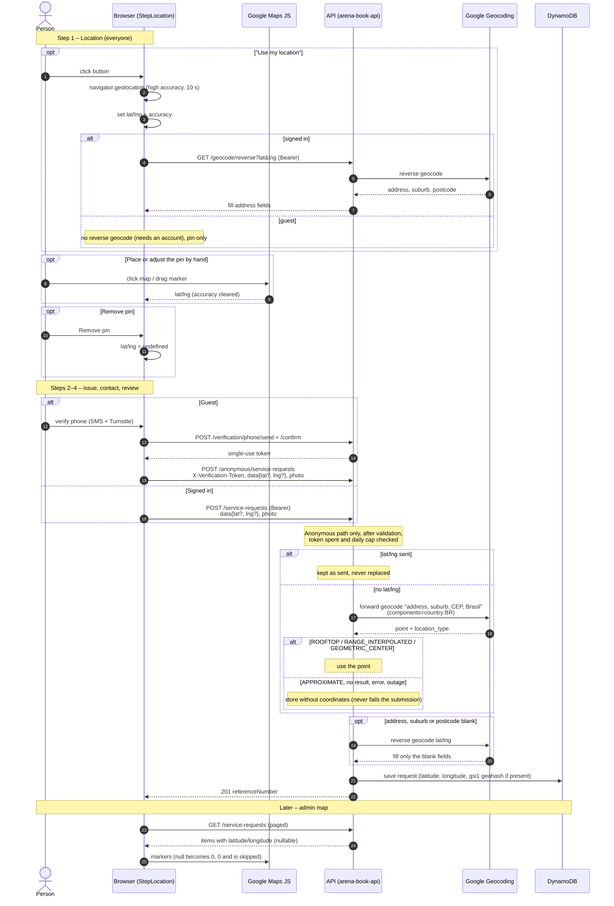

# Geocoordinates Flow

How a request's `lat`/`lng` are captured, sent, completed by the API and read back.
Related: `docs/api-contract.md` (sections 1, 2, 8), `docs/ANONYMOUS_SUBMISSION_SPEC.md`,
`docs/SERVICE_REQUEST_FORM_SPEC.md` (Step 1), `docs/REQUEST_MAP_SPEC.md`.

## Notes

- The signed-in path has no forward-geocoding fallback: a signed-in request without a pin is
  stored with no coordinates.
- Requests without coordinates never get a `gsi1` entry, so `/nearby` never returns them, and
  the admin map skips them.
- The pin never overwrites typed address text, and typing never moves the pin.
- Forward and reverse lookups on the anonymous path only run after the verification token is
  spent and the daily cap passed, so only a verified phone can cause a Google call.
